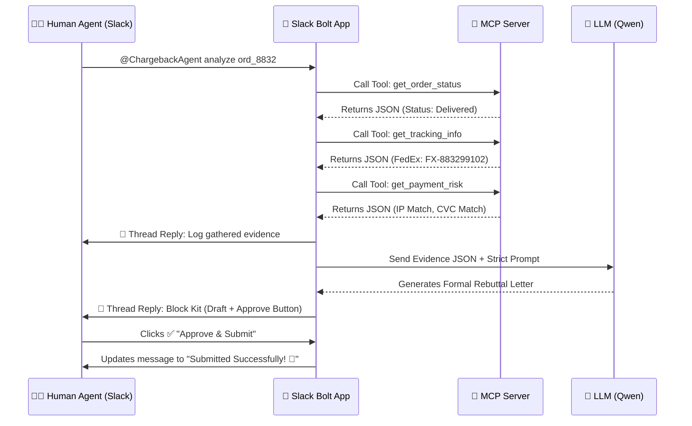

# The "Chargeback Dispute" Autopilot (Slack Edition)

## Elevator Pitch
An autonomous Slack Agent that instantly investigates e-commerce chargeback disputes, retrieves live evidence via MCP tools, and drafts formal bank rebuttal letters—all while keeping a human-in-the-loop directly in Slack.

## Inspiration
Every day, global e-commerce merchants lose millions of dollars to fraudulent credit card chargebacks. To fight this, a merchant must manually dig through Shopify for tracking numbers, Zendesk for chat logs, and Stripe for payment IP data, then write a tedious "Evidence Rebuttal Letter" to the bank. We wanted to completely automate this process where teams already work: Slack. 

## What it does
When a new chargeback arrives, you simply mention the agent in Slack (e.g., `@ChargebackAgent analyze ord_8832`), or click the "Investigate Now" button directly from the **Agent's App Home Dashboard**.
1. **Real-Time Context**: The agent executes a Slack Real-Time Search (RTS) query to find historical customer support conversations (like Zendesk tickets) across your workspace.
2. **Investigates**: The agent autonomously connects to our custom **MCP Server** to query external Shopify and Stripe APIs for tracking data and risk scores.
3. **Observability**: It replies in a thread, logging exactly what evidence it found and calculating a dynamic "Win Probability Score" so human agents trust its process.
4. **Drafts**: It uses an LLM to synthesize the JSON data into a strictly formatted legal rebuttal letter.
5. **Human-in-the-Loop & PDF Generation**: Using `views.open`, the agent presents an editing Modal. Once the human approves, the agent uses `pdfkit` to automatically generate a formal PDF Rebuttal Document and uploads it to the Slack channel via `files.uploadV2`, ready to be emailed to the bank.

## How we built it
- **Orchestration**: Node.js and `@slack/bolt` utilizing Slack's Socket Mode for real-time interactions and App Home/Modal surfaces.
- **The Tools (MCP Integration)**: We built a custom local `mcp-server` using `@modelcontextprotocol/sdk`. This server exposes tools like `get_tracking_info` and `get_payment_risk`. The Slack App acts as the MCP Client, dynamically calling these tools.
- **The Brain**: We integrated the Qwen 3.7 Max LLM for its superior long-context reasoning and strict instruction following, ensuring the generated bank letters never hallucinate evidence.

## Architecture Diagram

## Challenges we ran into
Integrating the brand-new MCP (Model Context Protocol) standard directly into a Slack Bolt app. We had to implement the `@modelcontextprotocol/sdk/client` via `StdioClientTransport` to ensure the Slack App could properly spawn and communicate with our custom Node.js tool server. 

## Accomplishments that we're proud of
We successfully shifted a complex, multi-dashboard financial workflow into a single, seamless Slack thread. By leveraging MCP tools and Block Kit buttons, we achieved true "Agentic" behavior with a safe, compliant Human-in-the-Loop pause.

## What we learned
Slack is the ultimate surface for AI. By bringing the agent to where the conversation already happens, the observability and trust in the AI's decision-making process skyrocket. 

## What's next for Chargeback Dispute Autopilot
- Moving from mock APIs to real OAuth connections with Stripe and Shopify.
- Implementing the Real-Time Search (RTS) API to let the agent search past Slack channel history for previous customer support conversations before drafting the rebuttal.
