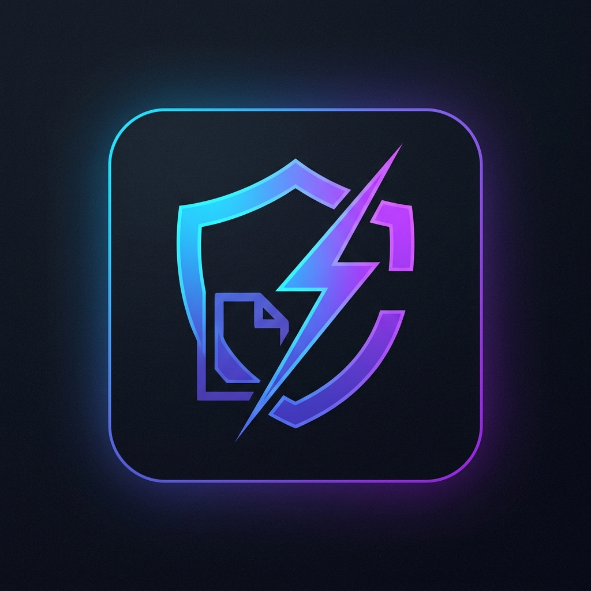
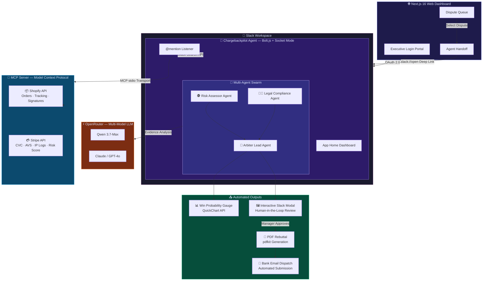

<p align="center">
  
</p>

<h1 align="center">Chargebackpilot</h1>

<p align="center">
  <b>🛡️ MCP-Powered Multi-Agent Slack Bot that Autonomously Investigates & Rebuts Bank Chargebacks</b>
</p>

<p align="center">
  
  
  
  
  
</p>

---

## 📋 Table of Contents

- [The Problem](#-the-problem)
- [The Solution](#-the-solution)
- [Architecture](#-architecture)
- [Project Structure](#-project-structure)
- [Features](#-features)
- [Tech Stack](#-tech-stack)
- [Getting Started](#-getting-started)
- [Environment Variables](#-environment-variables)
- [Usage & Demo](#-usage--demo)
- [Hackathon Track](#-hackathon-track)
- [License](#-license)

---

## 🔥 The Problem

Every year, small businesses and independent merchants lose over **$100 billion** to "friendly" chargeback fraud. When a customer falsely claims they never received an item, the burden of proof falls entirely on the merchant. Fighting a single dispute requires:

- Cross-referencing **Shopify** for shipping tracking numbers
- Pulling **Stripe** payment IP logs and CVC verification data
- Searching **Zendesk** or internal chat logs for prior customer communication
- Manually drafting a formal legal rebuttal letter to the bank

This process takes **4+ hours per dispute**. Most small businesses simply accept the loss.

---

## 💡 The Solution

**Chargebackpilot** is an Enterprise-grade SaaS application that transforms your Slack workspace into an autonomous chargeback investigation command center.

Instead of a simple chatbot, Chargebackpilot deploys a **Multi-Agent Swarm** — three distinct AI personas that actively debate the evidence inside a Slack thread before reaching a consensus and drafting a legally sound rebuttal document. It turns a 4-hour manual investigation into a **30-second automated workflow**.

---

## 🏗 Architecture



---

## 📂 Project Structure

This monorepo contains **three** interconnected projects:

```
Chargeback Dispute/
│
├── chargeback-dispute/          # 🌐 Next.js 16 Web Dashboard (Manager Portal)
│   ├── src/
│   │   ├── app/
│   │   │   ├── page.tsx         # Executive Login Page (OAuth + Deep Links)
│   │   │   ├── dashboard/       # Dispute Queue & Agent Handoff UI
│   │   │   └── api/             # REST API endpoints
│   │   └── lib/
│   │       ├── services.ts      # Mock Shopify/Stripe service layer
│   │       └── agent.ts         # LangGraph state machine (optional)
│   └── package.json
│
├── slack-app/                   # 🤖 Slack Bolt.js Agent (Core Engine)
│   ├── index.js                 # Full agent: MCP client, Swarm debate,
│   │                            #   Scorecard, PDF gen, bank email
│   └── package.json
│
├── mcp-server/                  # 🔌 Model Context Protocol Server
│   ├── index.ts                 # MCP tool definitions (Shopify, Stripe)
│   └── package.json
│
├── app_icon.png                 # Slack App Icon
├── Demo_Script.md               # 3-minute video recording script
├── STEP_BY_STEP_GUIDE.md        # Judge-friendly setup tutorial
├── DEPLOYMENT_GUIDE.md          # Production deployment guide
└── LICENSE                      # MIT License
```

---

## ✨ Features

### Slack Agent (`slack-app/`)
| Feature | Description |
|---|---|
| **Multi-Agent Swarm** | Three AI personas (Risk Assessor, Legal Compliance, Arbiter Lead) debate evidence in a Slack thread before drafting a rebuttal |
| **MCP Integration** | Securely fetches Shopify order/tracking data and Stripe risk vectors via the Model Context Protocol |
| **Slack Search API** | Queries your workspace's message history to find relevant customer service tickets |
| **AI Predictive Scorecard** | Calculates a Win Probability (%) with a dynamic radial gauge chart embedded in Block Kit |
| **Interactive Modals** | Human-in-the-loop review via native Slack Modal with editable draft text |
| **PDF Generation** | Dynamically generates a formatted legal rebuttal document using `pdfkit` |
| **Automated Bank Email** | Simulates secure dispatch of the finalized PDF to the bank's resolution API |
| **App Home Dashboard** | A rich, real-time command center showing all active disputes when you open the bot |
| **Link Unfurling** | Paste a Stripe transaction URL and the agent auto-populates risk data |

### Web Dashboard (`chargeback-dispute/`)
| Feature | Description |
|---|---|
| **Executive Login Portal** | Premium split-screen design with role-based entry (Manager, Investigator, Slack OAuth) |
| **Multi-Tenant OAuth** | "Add to Slack" button with full OAuth 2.0 redirect flow |
| **Dispute Queue** | Visual list of all active chargebacks with claim type, amount, and status |
| **Agent Handoff** | One-click bridge from the web portal into the native Slack Desktop app |
| **Deep Linking** | `slack://open` protocol for seamless web-to-desktop transitions |

### MCP Server (`mcp-server/`)
| Feature | Description |
|---|---|
| **`get_order_status`** | Returns Shopify order status and line items |
| **`get_tracking_info`** | Returns courier, tracking number, delivery date, and signature |
| **`get_payment_risk`** | Returns Stripe CVC check, AVS check, IP address, risk score, and auth method |
| **Supabase Ready** | Falls back to mock data, but is wired to connect to a live Supabase database |

---

## 🛠 Tech Stack

| Layer | Technology |
|---|---|
| **Slack Agent** | Node.js, `@slack/bolt`, Socket Mode |
| **MCP Server** | TypeScript, `@modelcontextprotocol/sdk`, stdio transport |
| **AI / LLM** | OpenRouter API (Qwen, Claude, GPT-4o routing) |
| **Web Frontend** | Next.js 16, React 19, TypeScript |
| **Styling** | Pure CSS (Glassmorphism, Animations) |
| **PDF Generation** | `pdfkit` |
| **Data Visualization** | QuickChart.io API (Radial Gauge Charts) |
| **Database** | Supabase (optional), In-memory mock data |

---

## 🚀 Getting Started

### Prerequisites
- **Node.js** v18+  
- **npm** v9+  
- A **Slack Workspace** with admin access  
- A **Slack App** created at [api.slack.com/apps](https://api.slack.com/apps)

### 1. Clone the Repository

```bash
git clone https://github.com/LasaKaru/Slack-Agent-Builder.git
cd Slack-Agent-Builder
```

### 2. Install Dependencies

```bash
# Install the Slack Agent dependencies
cd slack-app
npm install

# Install the MCP Server dependencies
cd ../mcp-server
npm install

# Install the Web Dashboard dependencies
cd ../chargeback-dispute
npm install
```

### 3. Configure Environment Variables

Create `.env` files in the appropriate directories (see [Environment Variables](#-environment-variables) below).

### 4. Run the Application

You need **two** terminal windows:

**Terminal 1 — Slack Agent + MCP Server:**
```bash
cd slack-app
npm start
```
> This boots both the Slack Bolt agent AND the MCP Server (spawned as a child process).

**Terminal 2 — Web Dashboard:**
```bash
cd chargeback-dispute
npm run dev
```
> Opens the Next.js dashboard at `http://localhost:3000`.

---

## 🔐 Environment Variables

### `slack-app/.env`
```env
# Socket Mode App-Level Token (starts with xapp-)
SLACK_APP_TOKEN=xapp-1-...

# Bot User OAuth Token (starts with xoxb-)
SLACK_BOT_TOKEN=xoxb-...

# From Basic Information → App Credentials
SLACK_CLIENT_ID=your_client_id
SLACK_CLIENT_SECRET=your_client_secret
SLACK_SIGNING_SECRET=your_signing_secret

# (Optional) For live AI responses
OPENROUTER_API_KEY=your_openrouter_key
```

### `chargeback-dispute/.env.local`
```env
NEXT_PUBLIC_SLACK_CLIENT_ID=your_slack_client_id
```

> ⚠️ **Never commit `.env` files.** They are excluded via `.gitignore`.

---

## 🎬 Usage & Demo

### Triggering the Agent
1. Open Slack and navigate to a channel where the bot is invited.
2. Type: `@Chargebackpilot analyze ord_8832`
3. Watch the Multi-Agent Swarm investigate, debate, and draft a rebuttal.
4. Click **"Review & Edit Draft"** to open the interactive Modal.
5. Click **"Generate PDF & Send"** to finalize and dispatch.

### Available Test Orders
| Order ID | Type | Win Probability | Scenario |
|---|---|---|---|
| `ord_8832` | Physical (Macbook Pro) | ~92% | Delivered with FedEx signature |
| `ord_9941` | Digital (SaaS Subscription) | ~88% | IP access log confirmed |
| `ord_7710` | Physical (Wireless Headphones) | ~35% | Proxy IP detected, CVC fail |
| `ord_5521` | Physical (Office Desk) | ~55% | Still processing, AVS mismatch |

### Terminal Logs
The Slack Agent outputs detailed, real-time execution logs:
```
[EVENT]  app_mention detected: "@Chargebackpilot analyze ord_8832"
[AGENT]  Initiating investigation for Order ID: ord_8832
[MCP]    Connecting to external databases for order ord_8832...
[MCP]    Executing Tool: get_order_status
[MCP]    Data returned: { status: 'Delivered', items: ['Macbook Pro 14-inch'] }
[MCP]    Executing Tool: get_payment_risk
[SYSTEM] Generating PDF Document for Order ID: ord_8832...
[NETWORK] Simulating secure email dispatch to resolutions-api@stripe.com...
```

---

## 🏆 Hackathon Track

**Track:** Slack Agents for Organizations

**Slack App ID:** `A0BGYT5PCFJ`

**Impact:** Chargebackpilot levels the playing field for small businesses by automating chargeback investigations that previously required hours of manual cross-referencing across multiple platforms. By bringing the entire workflow into Slack—where teams already collaborate—we reduce response time from hours to seconds and help merchants recover revenue that would otherwise be lost to fraud.

---

## 📄 License

This project is licensed under the **MIT License** — see the [LICENSE](LICENSE) file for details.

---

<p align="center">
  Built with ❤️ for the Slack Agent Builder Challenge 2026
</p>
